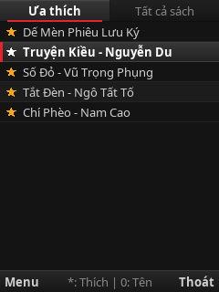
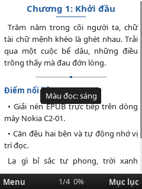
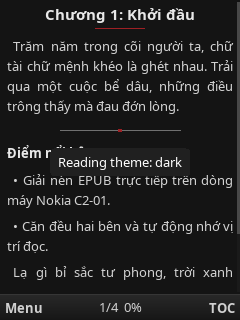

# BookReader (J2ME, Nokia C2-01)

Ứng dụng đọc sách **EPUB, HTML/XHTML, TXT** cho điện thoại Nokia Series 40 (CLDC 1.1 / MIDP 2.1 + JSR-75 FileConnection).

## Giao diện (Showcase)

| Thư viện sách | Giao diện Sáng | Giao diện Sepia | Giao diện Tối | Menu |
|:---:|:---:|:---:|:---:|:---:|
|  |  |  |  |  |

## Tính năng chính
- **Giao diện phong cách Opera Mini 4.4:** Thanh tiêu đề và phím mềm chuyển màu (gradient), danh sách nhỏ gọn kèm biểu tượng trực quan, thanh cuộn mảnh và thanh tiến độ đọc dưới chân trang.
- **Thư viện sách cố định:** Lần đầu mở ứng dụng, bạn chọn thư mục chứa sách; những lần mở sau ứng dụng hiển thị thẳng danh sách sách trong thư viện (có thể đổi thư mục bất cứ lúc nào).
- **Trình bày văn bản (Typography):**
  - Phân biệt tiêu đề chính (`h1`, `h2` căn giữa, in đậm, gạch chân nhấn), tiêu đề phụ (`h3`–`h6`), danh sách (`•`), đường kẻ ngang (`hr`).
  - Thụt đầu dòng, giãn khoảng cách đoạn và **căn đều hai bên (justify)** cho đoạn văn.
  - 3 cỡ chữ (nhỏ, vừa, lớn) và 3 giao diện màu (Sáng, Tối, Sepia).
- **Tối ưu chống tràn bộ nhớ (Anti-OOM cho heap ~2 MB):**
  - Tự cài đặt bộ giải nén **streaming DEFLATE** (`Inflate`) với cửa sổ trượt cố định 32 KB.
  - Đọc và lọc thẻ HTML/XML (`content.opf`, `toc.ncx`, `nav.xhtml`, chương XHTML) trực tiếp trên luồng `InputStream`, không nạp toàn bộ mảng byte giải nén hay chuỗi HTML thô vào RAM.
  - Tự động chia nhỏ chương siêu dài theo từng phần 32.000 ký tự và đọc file HTML/TXT rời theo từng cửa sổ 36 KB.
- **Giảm hỏi quyền đọc file trên Nokia S40:** Giữ nguyên một kết nối `FileConnection` cho mỗi cuốn sách trong suốt quá trình đọc.
- **Nhớ vị trí đọc (RMS):** Lưu chương, phần và dòng đang đọc cho từng cuốn sách.

## Build & Chạy thử
```bash
# Build ra dist/BookReader.jar và dist/BookReader.jad
./build.sh

# Đổi đường dẫn JDK 8 nếu cần
JDK8=/duong/dan/jdk-8 ./build.sh

# Chạy thử trên FreeJ2ME-Plus (cần cờ ISO_8859_1 trên JDK mới)
java -Dfile.encoding=ISO_8859_1 -jar /mnt/data/apps/freej2me-plus/build/freej2me.jar \
  file:///mnt/data/Work/mine/3.pets/j2me-bookreader/dist/BookReader.jar

# Render lại bộ ảnh showcase (240x320) vào thư mục docs/
./tools/capture-showcase.sh
```
*(Lưu ý: `lib/` đã chứa sẵn stub CLDC 1.1 / MIDP 2.0 / JSR-75 của MicroEmu và ProGuard để preverify bytecode).*

## Phím điều khiển khi đọc
| Phím | Chức năng |
|---|---|
| `Lên` / `Xuống` (`2` / `8`) | Cuộn 3 dòng |
| `Trái` / `Phải` (`4` / `6`), `OK` (`5`) | Lùi / tiến trang (tự chuyển phần/chương khi hết) |
| `1` / `3` | Chương trước / chương sau |
| Giữ `*` + `Lên` / `Xuống` | Tăng / giảm cỡ chữ (có thông báo nhanh trên màn hình) |
| Bấm `*` nhanh | Đổi vòng cỡ chữ (nhỏ → vừa → lớn) |
| `#` | Đổi giao diện (Sáng → Tối → Sepia) |
| Phím mềm trái hoặc `0` | Mở Menu (Mục lục, Đi tới %, Cỡ chữ, Giao diện, Danh sách sách…) |
| Phím mềm phải | Mở Mục lục |
