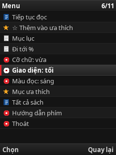
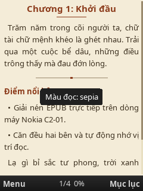

# BookReader (J2ME, Nokia C2-01)

Ứng dụng đọc sách **EPUB, HTML/XHTML, TXT** tối ưu cho điện thoại Java Nokia Series 40 (CLDC 1.1 / MIDP 2.0 + JSR-75 FileConnection).

## Giao diện

| Thư viện (Ưa thích) | Menu cài đặt | Đọc nền Sáng | Đọc nền Sepia | Đọc nền Tối |
|:---:|:---:|:---:|:---:|:---:|
|  |  |  |  |  |

## Điểm nổi bật
- **Phong cách Opera Mini 4.4:** Thanh tiêu đề và phím mềm chuyển màu (gradient), thanh cuộn mảnh, vạch tiến độ đọc tinh tế.
- **Tách biệt Giao diện & Màu đọc:** Tùy chọn độc lập giữa giao diện ứng dụng (`sáng` / `tối`) và màu trang giấy đọc (`sáng` / `tối` / `sepia`). Cho phép đọc chữ nền sáng trên giao diện tối.
- **Quản lý Thư viện:** Chia 2 tab *Ưa thích* và *Tất cả sách* (phím `*` để thêm/bỏ yêu thích, tự nhớ thư mục sách, menu cài đặt gọn gàng).
- **Hỗ trợ Chú thích (Footnote):** Phím `7`/`9` để duyệt chú thích, `OK` để mở hộp thoại đọc nội dung chú thích (căn đều 2 lề, cuộn mượt).
- **Trình bày văn bản chuẩn mực:** Căn đều 2 bên (justify), thụt đầu dòng, phân cấp tiêu đề (`h1`–`h6`), chú thích ảnh in nghiêng.
- **Chống tràn RAM tuyệt đối (Anti-OOM cho heap ~2 MB):**
  - Giải nén luồng streaming DEFLATE với cửa sổ cố định 32 KB.
  - Tự động chia nhỏ chương dài, đọc trực tiếp trên luồng InputStream.
  - Kiểm tra kích thước ảnh từ header; tự động thu nhỏ hoặc thay bằng placeholder nếu ảnh quá lớn để chống sập ứng dụng.
  - Giữ nguyên kết nối FileConnection, tránh hỏi quyền lặp lại trên Nokia S40.

## Phím tắt

### Khi đọc sách
| Phím | Chức năng |
|---|---|
| `Lên` / `Xuống` (`2` / `8`) | Cuộn dòng (hoặc cuộn nội dung chú thích) |
| `Trái` / `Phải` (`4` / `6`), `OK` (`5`) | Lùi / tiến trang (hoặc mở/đóng chú thích khi đang chọn) |
| `1` / `3` | Chương trước / sau |
| `7` / `9` | Chú thích trước / sau |
| `*` (bấm nhanh / giữ + Lên/Xuống) | Đổi cỡ chữ (nhỏ, vừa, lớn) |
| `#` | Đổi nhanh màu đọc (`sáng` → `tối` → `sepia`) |
| Phím mềm trái (`Menu`) | Mở Menu tùy chọn (Mục lục, Đi tới %, Cỡ chữ, Giao diện, Màu đọc...) |
| Phím mềm phải | Mở nhanh Mục lục |

### Trong danh sách sách / Mục lục
| Phím | Chức năng |
|---|---|
| `Trái` / `Phải` (`4` / `6`) | Chuyển qua lại giữa tab *Ưa thích* và *Tất cả sách* |
| `*` | Đánh dấu / Bỏ yêu thích cuốn sách đang chọn |
| `0` | Xem tên đầy đủ của sách trong hộp thoại popup |
| Cuộn ngang tự động (Marquee) | Tự cuộn tên sách dài khi dừng con trỏ |
| Phím mềm trái (`Menu`) | Đổi thư mục sách, Giao diện, Màu đọc, Cỡ chữ... |

## Cài đặt & Sử dụng
- File cài đặt: [dist/BookReader.jar](dist/BookReader.jar) (kèm [dist/BookReader.jad](dist/BookReader.jad)).
- Copy file `.jar` vào thẻ nhớ điện thoại (Nokia C2-01 hoặc máy hỗ trợ Java MIDP 2.0) và mở lên sử dụng.

### Build từ mã nguồn
```bash
./build.sh
```

### Script tối ưu sách EPUB (tùy chọn)
Tự động nén ảnh trong file EPUB về đúng chuẩn màn hình `232x280` trước khi chép vào máy:
```bash
./tools/optimize-epub.py "/duong/dan/sach.epub"
```
